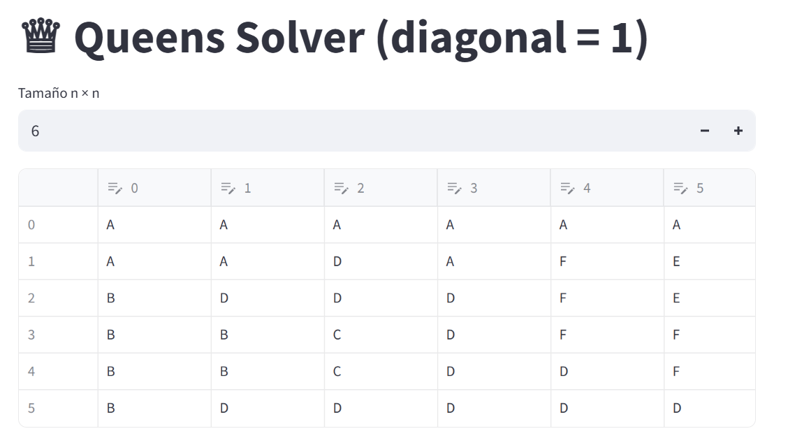

# ♕ queens-solver

**Queens Solver** is a logic puzzle solver and visual app designed to solve a variation of the classic N-Queens puzzle.

In this version:
> A queen attacks another if they are on the **same row**, **same column**, or **diagonally adjacent** (only 1 unit of diagonal distance).

The goal:
Place **one queen per color region** on the board such that no queens attack each other.

---

## 🌟 Features

- ♟️ Custom rule: **diagonal attack only at distance = 1**
- ⚡ Efficient solver using:
  - Backtracking
  - Forward checking
  - Unit propagation
  - MRV (minimum remaining values)
- 📷 **Board from a photo or screenshot**: the grid size and the color regions
  are recognised automatically (OpenCV), then solved instantly
- 🖌️ Instant board editor in [Streamlit](https://streamlit.io): pick a color,
  tap or swipe over the cells — painting runs in the browser, no reload
- 🧪 Test suite with `pytest` (solver + recognition on real and synthetic images)
- ✅ GitHub Actions CI included

---

## 📷 Demo

> You can run the visual version locally or deploy it online (Streamlit Cloud)



---

## 📦 Installation

```bash
git clone https://github.com/Leonardo-VERA/queens-solver.git
cd queens-solver
pip install -r requirements.txt        # app + recognition
pip install -r requirements-dev.txt    # pytest, black, isort
```

---

## 🎨 Streamlit app

```bash
streamlit run app/streamlit_app.py
```

1. **Photo / capture**: upload a screenshot of the puzzle, or take a photo of
   the screen (on a phone the uploader offers the camera). The **Caméra** tab
   uses the live camera instead.
2. The board is recognised and **solved immediately** — queens appear on the grid.
3. If a cell is wrong, pick the right color and tap (or swipe over) the cells:
   the board is re-solved after every stroke. *Annuler* undoes, the ✕ swatch erases.
4. Wrong grid size? Change *Taille de la grille*: the photo is re-read with that size.

Without a photo, just choose the size and paint the board by hand.

How the recognition works (`src/queens/vision/board_reader.py`):
find the board outline and straighten it → find the grid size from the grid
lines → read each cell's color (ignoring queens/crosses drawn in the middle)
→ group the colors into exactly *n* regions.

---

## 🧠 Command-line solver (CLI)

```bash
queens --file examples/board7.txt
```

Where `board7.txt` contains a region-based board:

```
AAAABBB
AAACBBB
AADCBBB
DDDCBDB
EEDDDDG
DDDFDDG
DDDFFGG
```

Output:

```
· Q · · · · ·
· · · Q · · ·
· · · · · Q ·
· · Q · · · ·
Q · · · · · ·
· · · · · · Q
· · · · Q · ·
```

---

## 🧪 Run tests

```bash
pytest
```

---

```
queens_solver/
├── app/
│   ├── streamlit_app.py   ← Streamlit app
│   └── board_editor/      ← in-browser grid editor (JS/CSS component)
├── examples/              ← Board samples
├── src/queens/            ← Solver and CLI
│   └── vision/            ← Board recognition from images
├── tests/                 ← Unit tests (+ tests/data sample screenshot)
├── requirements.txt
└── pyproject.toml
```

---

## 🧠 Rules Recap

- One queen must be placed per color region
- No two queens can be in the same row or same column
- Diagonal attacks are only allowed if adjacent (distance = 1)

---

## ☁️ Streamlit Community Cloud

Deploy the repo with **`app/streamlit_app.py`** as the main file;
`requirements.txt` already lists everything needed (`streamlit>=1.51`,
`opencv-python-headless`, ...).

---

## 🧑‍💻 Contributing

Pull requests are welcome!
Feel free to open issues for suggestions or bug reports.
